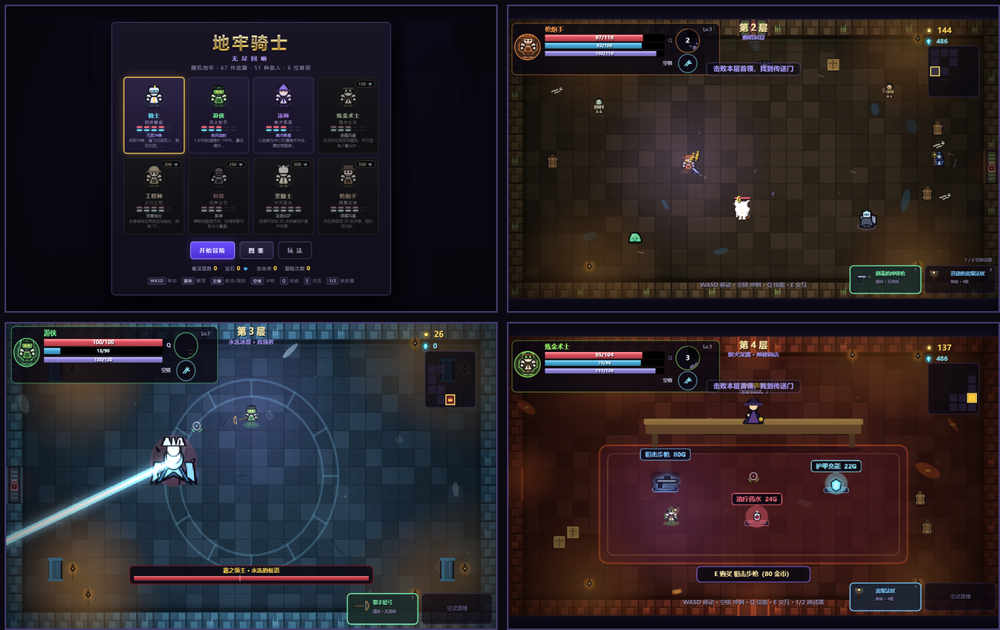

# 地牢骑士：无尽回响

一款**纯前端、零依赖**的类《元气骑士》俯视角肉鸽地牢射击游戏。

所有美术（角色、敌人、首领、武器、地块、道具）、音效与背景音乐全部由代码**程序化生成**，
没有使用任何外部图片、音频或游戏素材，也没有任何第三方运行库。



---

## 快速开始

**方式一（推荐）**：双击 `index.html`，或双击 `启动游戏.bat`。

**方式二**：把整个文件夹拖进浏览器窗口（Chrome / Edge / Firefox 现代版本均可）。

- 不需要安装、不需要联网、不需要本地服务器（使用普通 `<script>` 加载，支持 `file://` 直接运行）。
- 手机 / 平板：横屏打开，左半屏移动，右半屏瞄准并自动射击；技能、冲刺、交互按钮在右侧。
- 首次点击页面后才会解锁音频（浏览器的自动播放限制）。

---

## 手机 / 平板

手机浏览器直接打开就能玩，针对触屏做了这些适配：

- **自动进入触屏模式** —— 识别粗指针设备，从菜单点「开始冒险」立刻出现双虚拟摇杆，不用先戳一下画布才“唤醒”触屏。
- **全屏按钮** —— 标题页与暂停菜单都有「全 屏」，全屏后尝试锁定横屏（Android Chrome 支持；iPhone Safari 不支持元素全屏，请用下面的“添加到主屏幕”）。
- **添加到主屏幕** —— 内置 `manifest.json` 与程序化生成的图标，Android Chrome 选「安装应用」、iOS Safari 用「添加到主屏幕」，之后以全屏无地址栏启动。
- **竖屏也能玩** —— 竖屏会弹旋转提示，但提供「竖屏继续」，系统锁了旋转也不至于彻底卡死。
- **面板可滚动** —— 角色选择、图鉴、玩法说明、祝福、结算在手机上都能正常滑动（此前 `touch-action:none` 会把整页手势锁死）。
- **按钮尺寸补偿** —— 触屏动作按钮按实际显示缩放放大半径，小屏上物理直径仍 ≥ 40px。
- **面板自适应** —— 固定像素网格改成可收缩轨道，568×320 的老机型也不会横向溢出。

操作：左半屏拖动 = 移动，右半屏拖动 = 瞄准并自动开火；右下角按钮 = 技能 / 冲刺 / 换武器 / 交互，右上角 = 暂停。

---

## 联机（4 人，房主权威）

内置联机，服务端**零依赖**（手写 WebSocket 帧，不需要 npm install）。

### 启动服务器

```bash
node server/index.mjs              # 默认 8080
PORT=9000 node server/index.mjs    # 改端口（Windows: $env:PORT=9000; node server/index.mjs）
```

同一个端口同时提供游戏页面与 WebSocket，所以局域网里直接开 `http://<本机IP>:8080/` 就能玩，不用另起静态服务器。

### 怎么玩

1. 标题页点「联 机」
2. 大厅会列出**所有公开房间**（4 秒自动刷新，也可以点「刷新」），点「加入」直接进；也可以自己建房拿 4 位房间码
3. 房主点「开始游戏」，所有人同时进入第 1 层

### 同步模型

| 内容 | 做法 |
| --- | --- |
| 地图 | `generateFloor(floor)` 用 `RNG(floor*7919+1337)`，同层天然同图，**不需要传地图** |
| 怪物 | 只有房主生成与推进 AI，成员端按唯一编号 `nid` 跟随快照，不本地刷怪 |
| 队友攻击 | 房主端为每个成员维护一个真实 `Player`，把成员上报的输入注入进去驱动它，**队友的子弹在房主端真实参与伤害与掉落** |
| 自己的操作 | 本地立刻响应，不等服务器；位置每 50ms 互相同步 |
| **房间推进** | **房主过门后全队一起进入新房间**，成员不能自主过门；落点跟随房主，门的开关状态也同步 |
| 掉落物 | 房主打出的金币 / 药水 / 武器全队可见（按 `nid` 同步），谁捡谁得，捡走后另一端立即消失 |
| **倒地救援** | 血量归零进入 **20 秒倒地**，队友靠近按 `E` 拉起来（恢复 50% 生命）；读秒结束才真正阵亡 |
| **祝福共享** | 房主选完祝福，**全队同时获得**同一祝福 |
| **金币共享** | 全队一个金币池，谁捡都进公共账本，由房主记账；商店消费也从公共池扣 |
| 传送门 | 房主开启后同步到成员端，但只有房主能踩传送门推进楼层 |
| 快照频率 | 20Hz，敌人位置带插值平滑 |

### 注意

- 联机服务器必须走 https/wss（Render / Fly.io / Railway 等平台自动提供），浏览器会拦截 `ws://`。
- 服务端不做鉴权与限流，是给朋友之间开黑用的；要公开运营得自己加房间密码和频率限制。

---

## 操作

| 操作 | 键盘 / 鼠标 | 触屏 |
| --- | --- | --- |
| 移动 | `WASD` / 方向键 | 左半屏虚拟摇杆 |
| 瞄准 | 鼠标 | 右半屏虚拟摇杆 |
| 射击 / 挥砍 | 按住鼠标左键 | 右摇杆推动时自动开火 |
| 冲刺（短暂无敌） | `空格` | 右侧「冲刺」按钮 |
| 角色技能 | `Q` | 右侧「技能」按钮 |
| 交互 / 拾取 / 购买 / 传送 | `E` | 右侧「E」按钮 |
| 切换武器 | `1` / `2` / 鼠标滚轮 | 点按武器槽或「换」按钮 |
| 暂停 | `Esc` / `P` | 右上角暂停按钮 |
| 静音音效 | `M` | 暂停菜单 |

---

## 内容规模

| 类别 | 数量 | 说明 |
| --- | --- | --- |
| 武器 | **67** | 手枪 / 冲锋枪 / 步枪 / 霰弹枪 / 狙击枪 / 加特林 / 磁轨炮 / 激光 / 等离子 / 火箭 / 榴弹 / 火焰喷射器 / 酸液枪 / 特斯拉 / 弓弩 / 法杖 / 飞刀 / 回旋镖 / 飞轮 / 手里剑 / 长剑 / 巨剑 / 匕首 / 战斧 / 战锤 / 长矛 / 镰刀 / 武士刀 / 光剑 / 电锯 / 拳套 / 枪刃…… |
| 敌人 | **51** | 骷髅、蝙蝠、史莱姆、地精、巨魔、蜘蛛、木乃伊、蝎子、圣甲虫、沙虫、冰狼、雪怪、企鹅炸弹兵、火元素、熔岩犬、火龙蜥、浮游炮、异形虫、灵能者、眼魔、虚空行者…… |
| 首领 | **6** | 骸骨之王、石心魔像、霜之领主、熔岩暴君、机械核心、深渊之眼，全部拥有多阶段与独立招式表 |
| 角色 | **8** | 骑士、游侠、法师、炼金术士、工程师、刺客、圣骑士、枪炮手，技能与初始武器各不相同 |
| 主题 | **6** | 腐朽地牢、幽暗洞窟、黄沙遗迹、永冻冰原、熔火深渊、异星母巢，各有独立地块、配色、敌人池与首领 |
| 祝福 | **37** | 伤害、射速、暴击、吸血、弹射、穿透、元素附魔、连锁闪电、复活等 |
| 词缀 | 10 | 武器随机前缀（锋利的、迅捷的、冰封的……） |
| 精英词缀 | 6 | 铁甲、迅捷、狂暴、剧毒、巨型、暗影 |

另外包含：程序化房间地图、商店、宝箱房、挑战房、精英怪、元素状态、武器词缀、宝石解锁、图鉴、最高记录、本地存档。

---

## 游戏系统

### 资源
- **生命（红）**：只能靠治疗药水、部分祝福与首领掉落恢复。
- **护甲（蓝）**：优先承伤，脱战 3.6 秒后自动回复。
- **能量（紫）**：施法/射击消耗，随时间回复；能量不足会提示。
- **金币**：商店购买武器、药水与护甲充能。

### 房间与探索
- 每层由 6–11 个房间随机连通生成，包含入口、战斗房、商店、宝箱房、挑战房和首领房。
- 进入战斗房后大门封锁，清空敌人才能离开；首领倒下后开启大门并出现祝福选择。
- 击败首领 → 三选一祝福 → 房间中央出现传送门 → 进入下一层。
- 每 6 层为一个主题循环，深层难度持续提升。

### 战斗
- 武器分远程/近战/法术/投掷/光束/爆炸等开火模式，并附带燃烧、中毒、冰冻、眩晕、减速、连锁闪电、爆炸、追踪、弹射、回旋、黑洞牵引、吸血等效果。
- 敌人拥有 18 种行为：追击、游走、远程、狙击、蓄力冲锋、跳跃、飞行、炮台、激光、召唤、分裂、持盾、治疗、自爆、环绕、穿墙、投雷、钻地、炮击。
- 持盾敌人正面减伤，需要绕后；治疗敌人会为同伴回血；自爆敌人死亡时产生范围伤害。
- 冲刺有无敌帧，可穿过弹幕。

### 成长与存档
- 每层首领后三选一祝福，效果在本次冒险内永久叠加。
- 商店可用金币购买武器 / 治疗 / 护甲充能，离开商店再回来商品仍会保留（已购买的不会刷新）。
- 宝石在结算时按层数、击杀、首领数发放，用于永久解锁新角色。
- 最高层数、总击杀、冒险次数、已见武器/敌人、图鉴与设置写入 `localStorage`。

---

## 项目结构

```
dungeon-knight/
├─ index.html            入口
├─ 启动游戏.bat           双击启动
├─ manifest.json         PWA 清单（添加到主屏幕 / 全屏启动）
├─ icon.svg / icon-*.png 程序化生成的图标
├─ README.md
├─ DEPLOY.md             部署说明（Render 单服务器模式，含完整操作步骤）
├─ screenshot.png
├─ css/
│  └─ style.css          菜单 / 图鉴 / 祝福 / 结算等 DOM 界面样式
├─ server/
│  └─ index.mjs          零依赖联机服务端（WebSocket 房间转发 + 静态托管）
├─ js/
│  ├─ util.js            常量、数学、输入、音频、粒子、存档
│  ├─ art.js             程序化像素美术（敌人/首领/角色/武器/地块/道具）
│  ├─ weapons.js         67 件武器数据 + 开火/近战逻辑
│  ├─ enemies.js         51 种敌人数据 + 18 种 AI
│  ├─ bosses.js          6 个首领的数据、贴图与招式
│  ├─ entities.js        弹幕、挥砍、光束、掉落物、炮台、伤害数字
│  ├─ player.js          8 个角色、技能、移动、承伤与绘制
│  ├─ dungeon.js         楼层生成、房门、地块烘焙、道具、传送门
│  ├─ ui.js              HUD、菜单、图鉴、祝福、触屏控制
│  ├─ game.js            状态机、主循环、掉落、祝福、楼层推进
│  ├─ net.js             联机模块（房主权威快照 / 输入上行 / 队友渲染）
│  └─ main.js            启动、画布缩放、全屏 / 视口适配、主循环
└─ tools/                开发测试工具（玩游戏不需要）
   ├─ smoke.mjs          无头逻辑测试
   ├─ cdp.mjs            真实浏览器端到端测试
   ├─ mobile-check.mjs   手机视口回归测试
   ├─ net-smoke.mjs      联机服务端协议测试
   ├─ net-check.mjs      联机端到端测试（双客户端）
   └─ make-icons.py      程序化生成 PWA 图标
```

---

## 技术实现

- **纯原生 JavaScript + Canvas 2D**，没有构建步骤、没有 npm 依赖。
- **程序化像素美术**：所有 Sprite 在运行时用 Canvas 绘制到离屏画布并缓存；
  同一套绘制函数通过调色板/配件组合出数十种敌人与武器图标。
- **双层渲染**：世界以 960×544 像素风离屏画布渲染后按整数/最近邻放大；
  HUD 与文字在实际显示分辨率上单独绘制，中文清晰不糊。
- **程序化音频**：WebAudio 合成枪声、爆炸、激光、拾取等 40 余种音效；
  6 套主题音阶驱动的芯片音乐循环。
- **种子随机**：楼层布局、房间内容、地块装饰使用带种子的 RNG，方便复现与测试。
- **本地存档**：`localStorage` 保存宝石、解锁、图鉴、记录与音频设置。
- **移动端适配**：粗指针检测 + Pointer Events 双摇杆；`visualViewport` 驱动画布尺寸；触屏按钮按显示缩放反向补偿半径；CSS 用 `env(safe-area-inset-*)` 适配刘海屏；面板统一 `touch-action:pan-y` 保证可滚动。

---

## 自动化测试

源码目录内提供了两套测试（需要 Node.js，仅开发时使用）：

```bash
# 1) 无头逻辑测试：stub Canvas/DOM，覆盖全部武器、全部敌人、全部首领、
#    30 层地图连通性、8 层战役推进、商店/宝箱/传送门/存档等 61 项断言
node tools/smoke.mjs .

# 2) 真实浏览器端到端测试：通过 Chrome DevTools Protocol 驱动 Edge，
#    验证点击开局、真实键鼠、触屏摇杆与按钮、音频解锁、Boss/祝福/传送门、
#    图鉴、暂停、结算、帧率等 41 项检查
node tools/cdp.mjs .

# 3) 手机视口回归：CDP 模拟 812×375 / 568×320 / 390×844 三种屏幕，
#    验证触屏模式、面板不溢出、按钮尺寸补偿、图鉴滚动、竖屏逃生通道等 33 项
node tools/mobile-check.mjs .

# 4) 联机服务端协议：建房 / 加入 / 转发 / 房主转移 / 房间回收等 15 项
node tools/net-smoke.mjs .

# 5) 联机端到端：真服务器 + 两个真浏览器页面，
#    验证房间列表、开局同步、队友互见、移动同步、怪物编号一致、
#    成员开火在房主端结算、房主过门全队跟随、掉落物同步、
#    祝福共享、金币共享、倒地救援、传送门同步等 43 项
node tools/net-check.mjs .

# 6) 重新生成 PWA 图标（纯标准库，无第三方依赖）
python tools/make-icons.py .
```

五套测试均通过（61 + 41 + 33 + 15 + 43 = 193 项，0 失败，无 JS 异常；桌面实测约 60 FPS）。

---

## 小贴士

- 能量武器很强，但别把能量打空；留一点能量放技能往往能保命。
- 持盾敌人（墓穴守卫、霜甲卫士）正面几乎免伤，绕后或用手雷/爆炸武器。
- 黑球、虚空权杖可以把敌人吸成一堆，再补一发火箭筒。
- 冲刺不仅用来逃跑，也可以穿过弹幕贴脸输出。
- 每层商店的武器品质随层数提高，攒钱在深层买传说武器很划算。
- 宝石结算与层数、击杀数、首领数挂钩，多推进一层收益很高。

---

## 说明

- 推荐使用较新的 Chrome / Edge / Firefox；`file://` 直接打开即可运行。
- 若浏览器限制了本地文件音频，点击一次页面或「开始冒险」即可解锁。
- 手机通过 `http(s)` 托管（GitHub Pages 等）时才能“添加到主屏幕”，`file://` 下 manifest 不会生效。
- 本作是原创实现，未使用任何既有游戏项目的代码或资源。
